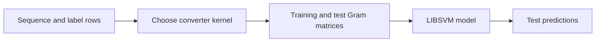

# StringKernel4LIBSVM

Compare labeled sequences, such as DNA fragments or short words. This tool turns
their similarities into a table for LIBSVM classification or regression: each
row represents a target sequence, and each column represents a training reference.

StringKernel4LIBSVM converts labeled sequences into normalized string-kernel
matrices for LIBSVM. It includes the converter, a C++17 kernel library, and the
unmodified LIBSVM 3.37 training and prediction programs.

The default is the weighted-degree string kernel with degree `5`. DSK and WDSK
compare matches at the same positions; spectrum and subsequence kernels do not
require alignment. See [kernel definitions](docs/KERNELS.md).

## Build and run the supplied regression example

Use a C++17 compiler, CMake 3.25 or newer, and Python 3.9 or newer for the
initial dependency bootstrap. The script downloads the six required official
LIBSVM files at an exact commit and verifies their SHA-256 digests. After that
step, production configuration and builds need neither Python nor network access.

On Linux or macOS, run these commands from the repository directory:

```sh
python3 scripts/fetch_libsvm.py
cmake -S . -B build/release -DBUILD_TESTING=OFF -DCMAKE_BUILD_TYPE=Release
cmake --build build/release --config Release
mkdir -p build/example
./build/release/StringKernelConverter -train examples/regression/train_sequences.tsv -k 5 > build/example/train.kernel
./build/release/StringKernelConverter -train examples/regression/train_sequences.tsv -test examples/regression/test_sequences.tsv -k 5 > build/example/test.kernel
./build/release/svm-train -s 3 -t 4 build/example/train.kernel build/example/model
./build/release/svm-predict build/example/test.kernel build/example/model build/example/predictions.txt
```

Dependency sources are cached under ignored `third_party/libsvm/`; rerunning the
bootstrap verifies and reuses a complete cache offline. See [offline setup and
recovery](docs/DEVELOPMENT.md#bootstrap-libsvm-and-work-offline).

The last command writes one prediction per test record to
`build/example/predictions.txt`. The supplied labels are continuous, so the example
uses epsilon-SVR with `-s 3`. LIBSVM's `-t 4` selects a precomputed kernel.

On Windows, open a Visual Studio developer command prompt with a C++17 toolchain.
For Visual Studio 2026, use CMake 4.2 or newer.

```bat
python scripts/fetch_libsvm.py
cmake -S . -B build/release -DBUILD_TESTING=OFF
cmake --build build/release --config Release
sample.bat build\release\Release
```

`sample.bat` writes the same artifacts under `build\example` and stops on errors.
For a generator that puts executables directly in `build\release`, pass that
directory instead. In PowerShell, invoke the batch file as `./sample.bat`. Use
this batch file or `cmd /c` for native output redirection on older PowerShell
versions. Their default `>` encoding can produce UTF-16 text that LIBSVM cannot
read.

## Convert your sequences

Each nonblank line contains a sequence token and a finite numeric label:

```text
ACDE 1
ACDF -1
```

Separate fields with spaces or tabs. Sequences are case-sensitive byte strings.
The parser accepts LF, CRLF, and a final line without a newline. It rejects empty
datasets, missing labels, extra fields, and invalid numbers with a source and
line diagnostic. Save text without a byte-order mark.

Use the same training file, record order, kernel type, and parameter values for
both conversions. A test matrix always has one column per original training record.
Keep all output columns, including zero values and the `0:serial` field. Do not
run `svm-scale` on these matrices as though they were ordinary feature vectors.

`StringKernelConverter --help` lists the options. The converter's stable numeric
IDs are `-t 0` positional, `-t 1` weighted degree, `-t 2` spectrum, and `-t 3`
subsequence. You can also use the readable `--kernel` names. These type numbers
belong to the converter. The bundled `svm-train` needs `-t 4` for any converted
matrix.

## Choose a kernel and run a small classification example

A kernel turns each pair of sequences into a similarity score. The converter
writes those scores as a Gram matrix; LIBSVM learns a model from the labeled
training rows and uses the test-to-training scores to predict test labels.
Every input row, including a test row, needs a label field. If a test label is
unknown, use `0`; LIBSVM prediction ignores that field.



Each kernel measures a different kind of match:

| Kernel | What it compares | Choose it when |
| --- | --- | --- |
| `positional` / `-t 0` | Same byte at the same position | Inputs have equal lengths and are already aligned. |
| `weighted-degree` / `-t 1` | Same-position substrings up to `-k` bytes | Aligned local matches matter at several lengths. This remains the default. |
| `spectrum` / `-t 2` | Exact contiguous `-k`-mers, wherever they occur | A short exact pattern should still match after it moves. |
| `subsequence` / `-t 3` | Ordered `-k`-byte patterns, allowing gaps | Preserve a pattern match when insertions create gaps; expect more computation. |

The example files contain four labeled training strings and two held-out strings:
`ACG`/`ACT` are positive; `GGA`/`GGT` are negative. At spectrum `k=2`, the
positive pair shares `AC` and the negative pair shares `GG`. Held-out `ACC` and
`GGC` share those corresponding 2-mers. Run the spectrum example:

```sh
mkdir -p build/string-kernel-example
./build/release/StringKernelConverter -train examples/string-kernels/spectrum-train.tsv --kernel spectrum -k 2 > build/string-kernel-example/spectrum.train
./build/release/StringKernelConverter -train examples/string-kernels/spectrum-train.tsv -test examples/string-kernels/spectrum-test.tsv --kernel spectrum -k 2 > build/string-kernel-example/spectrum.test
./build/release/svm-train -q -t 4 build/string-kernel-example/spectrum.train build/string-kernel-example/spectrum.model
./build/release/svm-predict build/string-kernel-example/spectrum.test build/string-kernel-example/spectrum.model build/string-kernel-example/spectrum.predictions
```

The predictions for these two held-out rows are `1` and `-1`. The example is a
small correctness demonstration, not a claim about accuracy on other data.

For gapped matches, run the same fixture with the fixed-length subsequence
kernel and a gap-decay value. Keep the same kernel settings for both matrices:

```sh
./build/release/StringKernelConverter -train examples/string-kernels/spectrum-train.tsv --kernel subsequence -k 2 --decay 0.5 > build/string-kernel-example/subsequence.train
./build/release/StringKernelConverter -train examples/string-kernels/spectrum-train.tsv -test examples/string-kernels/spectrum-test.tsv --kernel subsequence -k 2 --decay 0.5 > build/string-kernel-example/subsequence.test
./build/release/svm-train -q -t 4 build/string-kernel-example/subsequence.train build/string-kernel-example/subsequence.model
./build/release/svm-predict build/string-kernel-example/subsequence.test build/string-kernel-example/subsequence.model build/string-kernel-example/subsequence.predictions
```

As a tiny feature example, `ACG` and `AG` share the length-2 ordered
subsequence `AG` with a gap. With decay `0.5`, their normalized subsequence
kernel is `1/3`; their spectrum `k=2` maps are `{AC, CG}` and `{AG}`, so they
share no features and the score is zero. See [the formulas, parameter meanings,
and analytical costs](docs/KERNELS.md).

For a visual walkthrough of aligned, moved, and gapped motifs across three tiny
datasets, see the [kernel separation analysis](docs/ANALYSIS.md). It includes
similarity heatmaps and predictions from the actual LIBSVM tools; the examples
are intentionally constructed and do not estimate real-world accuracy.

These examples still use the repository's input format: one case-sensitive byte
token and one finite label per line. Inputs are not parsed as FASTA, and the
converter does not choose an alphabet, align records, tune parameters, or run
cross-validation. All conversion commands for one model must use the same
converter kernel and parameter values, and the test matrix must keep the original
training row order. The converter's `--kernel` chooses sequence similarity;
LIBSVM's separate `svm-train -t 4` selects its precomputed-matrix mode. A `k`
larger than a sequence length is valid and gives that sequence an empty feature
map for spectrum or subsequence. WDSK still includes all available substring
orders up to the sequence length, and DSK does not use `k` in its score.

## Develop and install

For tests, TDD, sanitizers, coverage, offline test dependencies, installation, and
the library API, see [development instructions](docs/DEVELOPMENT.md) and
[contribution requirements](CONTRIBUTING.md).

The modernized C++ API and stricter input rules are intentional changes. See
[compatibility](docs/COMPATIBILITY.md), [design](docs/DESIGN.md), and
[validation evidence](docs/VALIDATION.md). The incomplete `legacy/paired_sequence_analyzer.cpp`
remains unsupported historical source and is excluded from the build.

LIBSVM's license and exact source pin are in
[third-party notices](THIRD_PARTY_NOTICES.md). This modernization does not assign
a license to the historical project.
