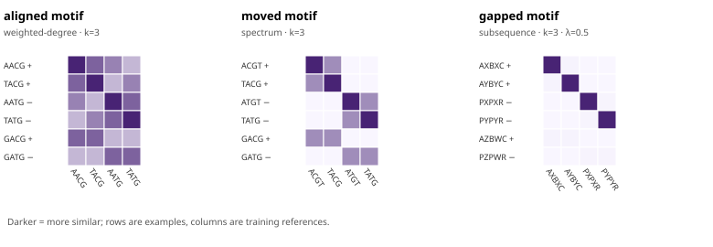

# A visual tour of string-kernel separation

These three small, synthetic datasets make different sequence patterns easy to
see. Each panel uses the kernel that matches the pattern being illustrated.
Rows show training and held-out examples; columns show the training references.
Darker cells mean higher normalized similarity.



## The examples

| Dataset | Positive training strings | Negative training strings | Held-out strings (`+`, `−`) | Kernel and lesson |
| --- | --- | --- | --- | --- |
| Aligned motif | `AACG`, `TACG` | `AATG`, `TATG` | `GACG`, `GATG` | Weighted degree, `k=3`: the class cue stays at the same positions. |
| Moved motif | `ACGT`, `TACG` | `ATGT`, `TATG` | `GACG`, `GATG` | Spectrum, `k=3`: exact 3-mers still match after moving. |
| Gapped motif | `AXBXC`, `AYBYC` | `PXPXR`, `PYPYR` | `AZBWC`, `PZPWR` | Subsequence, `k=3`, decay `0.5`: `ABC` and `PPR` remain ordered through inserted bytes. |

The gapped example uses `X`, `Y`, `Z`, `W`, and the other letters as ordinary
case-sensitive byte tokens. It does not assign DNA or protein meaning to them.

## What the similarities show

The table reports the mean off-diagonal similarity for same-label training
pairs and for different-label training pairs. Values are computed from the
converter's normalized matrix and checked against a separate feature-map
calculation.

| Constructed dataset | Selected kernel | Within-class mean | Between-class mean |
| --- | --- | ---: | ---: |
| Aligned motif | Weighted degree, `k=3` | 0.700 | 0.425 |
| Moved motif | Spectrum, `k=3` | 0.500 | 0.000 |
| Gapped motif | Subsequence, `k=3`, decay `0.5` | 0.013 | 0.000 |

These values describe only the four training records in each fixture. The
gapped strings share the selected ordered pattern, but also contain many
different subsequences; a small similarity is still meaningful here because
the selected-class similarities exceed the cross-class similarities.

The actual LIBSVM train/predict workflow returned the expected held-out labels
`1, -1` for each selected kernel. The fixtures are intentionally designed so
the pattern and label agree. This verifies the converter-to-solver workflow; it
does not measure generalization, biological usefulness, accuracy on external
data, or relative runtime. The panels also are not a head-to-head kernel
benchmark: each uses a different dataset construction and a selected fit.

## Reproduce

Build the converter and upstream solver as described in the
[development guide](DEVELOPMENT.md#build-and-run-tests), then run from the
repository root:

```sh
python3 scripts/analyze_separation.py \
  --converter build/dev/StringKernelConverter \
  --trainer build/dev/svm-train \
  --predictor build/dev/svm-predict \
  --output-dir build/separation-analysis
```

Open `build/separation-analysis/analysis.md` and
`build/separation-analysis/similarities.svg`. To refresh the published SVG,
copy the generated file to `docs/analysis/similarities.svg`; the CTest analysis
check compares regenerated bytes with this figure and verifies the real solver
predictions. The runner allows output outside the checkout or under its ignored
`build/` directory, and refuses other in-checkout paths so it cannot overwrite
source files.

The generator uses only Python's standard library and tiny checked-in records.
It independently checks converter matrices before training the models. No
external datasets, downloaded packages, tuning, or cross-validation are part
of this demonstration.
